# Convite · Organización de eventos familiares

App Android en **Ionic + Angular** y vista web en **Cloudflare Pages** para
organizar eventos familiares: **invitaciones por WhatsApp con código QR**,
**confirmación de asistencia en tiempo real**, **lista de regalos anónima**,
**presupuesto, tareas, registro de llegadas sin conexión y galería compartida**.

[](https://convite-4v8.pages.dev)


<p align="center">
  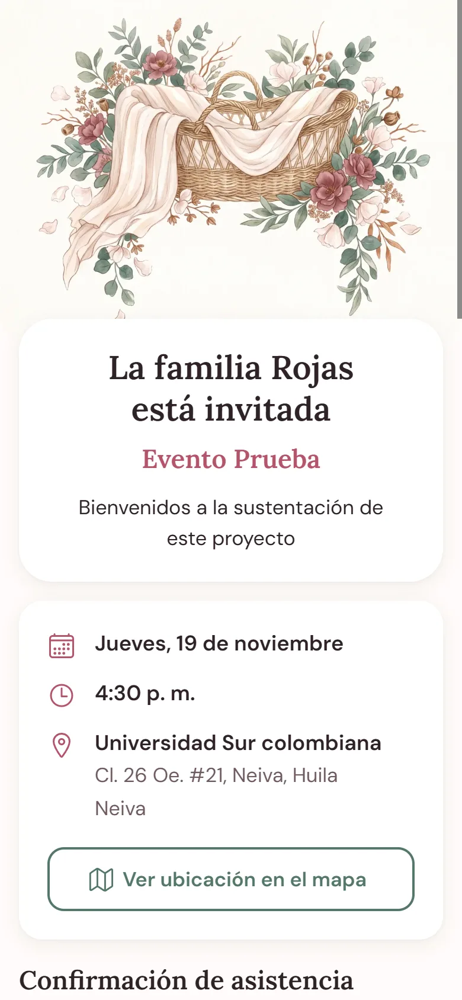
  &nbsp;&nbsp;
  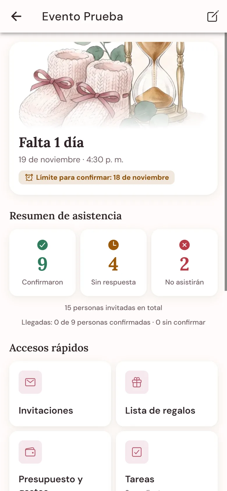
  &nbsp;&nbsp;
  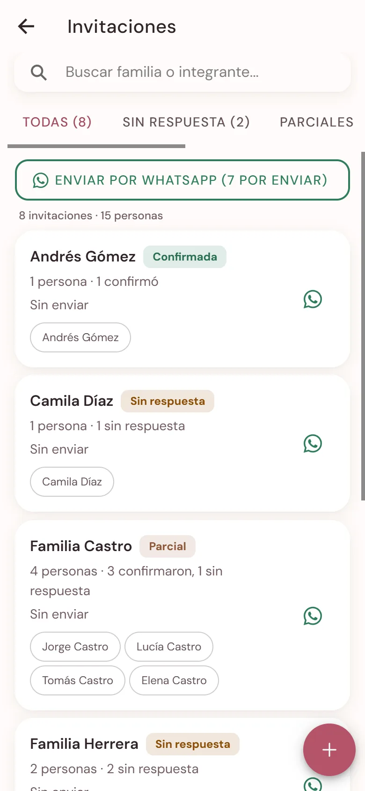
</p>

<p align="center"><sub>Capturas tomadas en un teléfono de 390 px usando un evento de prueba con datos ficticios.</sub></p>

**Vista web de invitados:** <https://convite-4v8.pages.dev> (cada invitación se abre en `/i/<código>` y su lista de regalos en `/i/<código>/regalos`).

---

## Contenido

- [Sobre el proyecto](#sobre-el-proyecto)
- [Roles y permisos](#roles-y-permisos)
- [Funcionalidades](#funcionalidades)
- [Hardware y permisos](#hardware-y-permisos)
- [Reglas del negocio](#reglas-del-negocio)
- [Arquitectura](#arquitectura)
- [Seguridad](#seguridad)
- [Modelo de datos](#modelo-de-datos)
- [Stack tecnológico](#stack-tecnológico)
- [Estructura del proyecto](#estructura-del-proyecto)
- [Instalación y uso local](#instalación-y-uso-local)
- [Pruebas](#pruebas)
- [Generar el APK](#generar-el-apk)
- [Despliegue](#despliegue)
- [Avance por etapas](#avance-por-etapas)
- [Pendiente](#pendiente)
- [Autor](#autor)

---

## Sobre el proyecto

Proyecto académico desarrollado en la **Universidad Surcolombiana**. La primera
versión se construyó para un baby shower real en Neiva (29 de noviembre de 2026)
y quedó preparada para reutilizarse en **bautizos, cumpleaños, bodas y
aniversarios**: todas las pantallas mantienen la misma estructura y solo cambian
el tema visual (colores, portada e ilustraciones) y los textos según el tipo de
evento (`event_type`) y la persona festejada (`honoree_name`).

Hay dos formas de usar Convite:

- **App Android (organizadores):** gestión completa del evento, invitaciones,
  presupuesto, tareas, control de entrada y galería.
- **Vista web (invitados):** acceso directo en el navegador mediante código QR o
  enlace de WhatsApp, sin instalar la app ni crear cuenta.

| Requisito | Cómo se cumple |
|---|---|
| App móvil multiplataforma / nativa | Ionic 9 con Angular 22 standalone (sin Zone.js, estado con signals) y Capacitor 8 para Android |
| Consumo de backend asíncrono | API REST, Auth, Realtime, Storage y funciones RPC de Supabase con capa de reintentos y manejo de red (`resilient-fetch`) |
| Uso de hardware con permisos en tiempo de ejecución | Cámara (`@capacitor/camera`) y lector QR (`@capacitor/barcode-scanner`) con verificación, solicitud y redirección a ajustes mediante plugin Java propio (`AppSettingsPlugin`) |
| Persistencia local | `@capacitor/preferences` guarda la cola de llegadas pendientes y la última copia descargada de invitados |
| Estados de carga, error y reintento | Todas las vistas muestran indicadores de carga, mensajes de error con botón "Reintentar" e idempotencia en operaciones críticas |
| Seguridad en base de datos | Row Level Security (RLS) activo en las 16 tablas; los invitados solo interactúan a través de funciones RPC validadas por código |

---

## Roles y permisos

La app distingue dos roles para organizadores dentro de `event_members`
(propietario y ayudante) y un acceso anónimo acotado para los invitados en la
web.

| Capacidad | Propietario | Ayudante | Invitado (web) |
|---|:---:|:---:|:---:|
| Ver el panel del evento y asistencia en tiempo real | ✅ | ✅ | — |
| Crear y editar el evento (datos, tipo, festejado y tema) | ✅ | — | — |
| Crear, editar y enviar invitaciones (individuales o grupo) | ✅ | ✅ | — |
| Administrar tandas de confirmación (`invitation_batches`) | ✅ | — | — |
| Ver registro de respuestas (`rsvp_log`) | ✅ | ✅ | — |
| Registrar llegadas con QR o búsqueda (incluso sin conexión) | ✅ | ✅ | — |
| Subir fotos a la galería y verlas | ✅ | ✅ | — |
| Borrar fotos de la galería | Cualquiera del evento | Solo las propias | — |
| Ver y marcar tareas; crear o editar tareas | ✅ | Solo ver y marcar | — |
| Administrar lista de regalos y consultar reservas | ✅ | — | — |
| Administrar presupuesto, categorías, gastos y abonos | ✅ | — | — |
| Administrar perfiles del equipo (quién paga o hace una tarea) | ✅ | Solo ver | — |
| Ver invitación, confirmar asistencia por persona y abrir su QR | — | — | ✅ |
| Elegir o liberar regalos de forma anónima | — | — | ✅ |

---

## Funcionalidades

### App Android para organizadores

#### Acceso, panel y temas

- **Inicio de sesión:** autenticación con correo y contraseña contra Supabase
  Auth; la app no tiene registro abierto (las cuentas se administran desde el
  backend).
- **Temas por evento:** actualmente incluye **Jardín de algodón** (`baby-shower`)
  y **Miel y flores silvestres** (`honey-bee`), definidos en `src/theme/` y
  `src/assets/themes/`.
- **Panel del evento:** muestra cuenta regresiva hacia la fecha del evento,
  fecha límite para confirmar, resumen de asistencia por persona (confirmaron,
  sin respuesta, no asistirán), contador de llegadas, respuestas recientes y
  accesos rápidos filtrados según el rol. Se actualiza al instante mediante
  Supabase Realtime.

| Inicio de sesión | Panel (propietario) | Accesos rápidos (propietario) | Accesos rápidos (ayudante) |
|:---:|:---:|:---:|:---:|
| 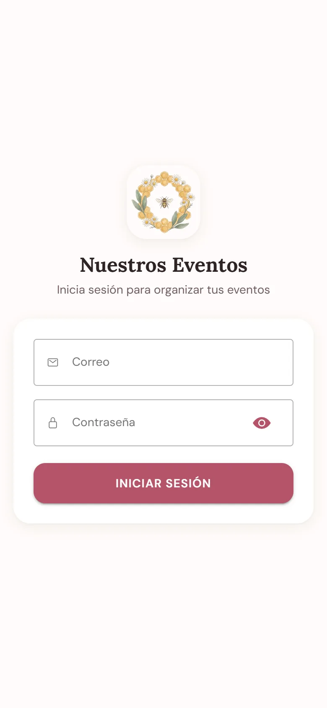 |  | 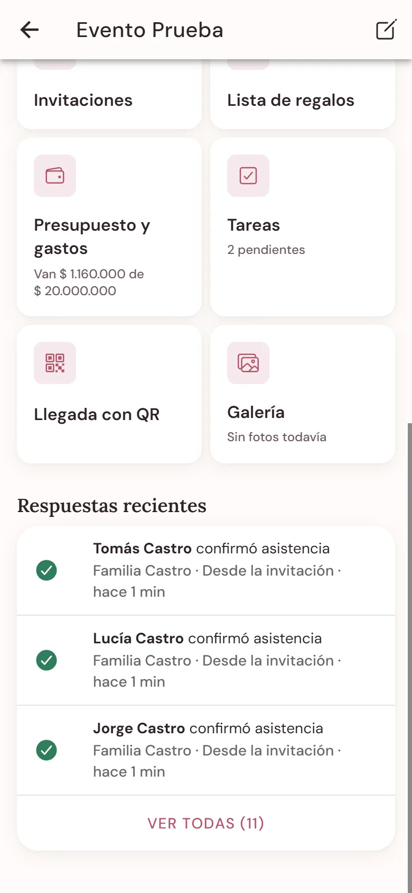 | 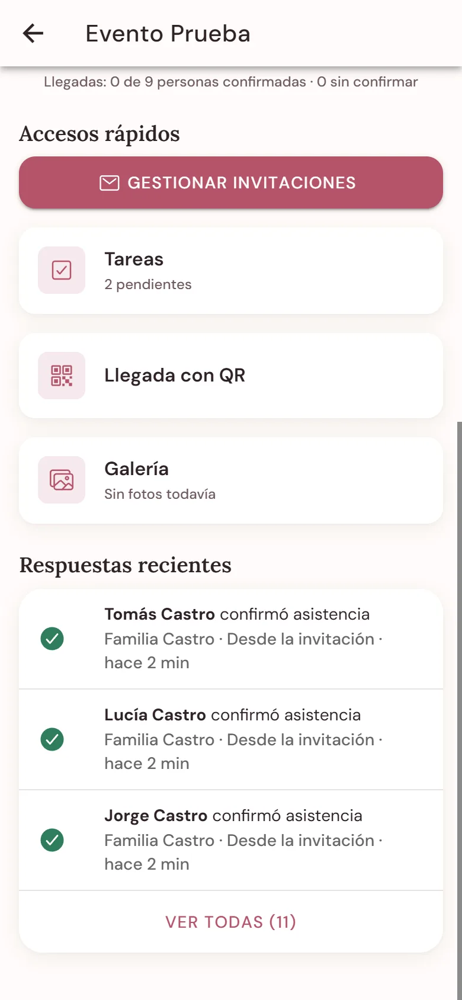 |

#### Invitaciones, envío por WhatsApp y respuestas

- **Invitaciones individuales o de grupo:** cada invitación genera un código
  único de 10 caracteres, valida celular colombiano (`+57 3xx`) y permite
  asignarle una tanda con su propia fecha límite.
- **Lista con filtros y búsqueda:** búsqueda por nombre de familia o integrante,
  filtro por tanda y por estado (`Todas`, `Sin respuesta`, `Parciales`,
  `Confirmadas`, `No asistirán`), además de paginación.
- **Envío en serie por WhatsApp:** cola dedicada en "Enviar invitaciones" que
  muestra el progreso (`1 de 8 enviadas`), abre WhatsApp con el mensaje y enlace
  listos, permite "Saltar por ahora" y marca cada invitación como enviada.
- **Registro de respuestas:** historial cronológico que indica quién cambió su
  respuesta, el estado anterior y el nuevo, cuándo ocurrió y desde dónde se hizo
  (invitación web o app del equipo).

| Lista de invitaciones | Detalle y código QR | Envío en serie por WhatsApp | Registro de respuestas |
|:---:|:---:|:---:|:---:|
|  | 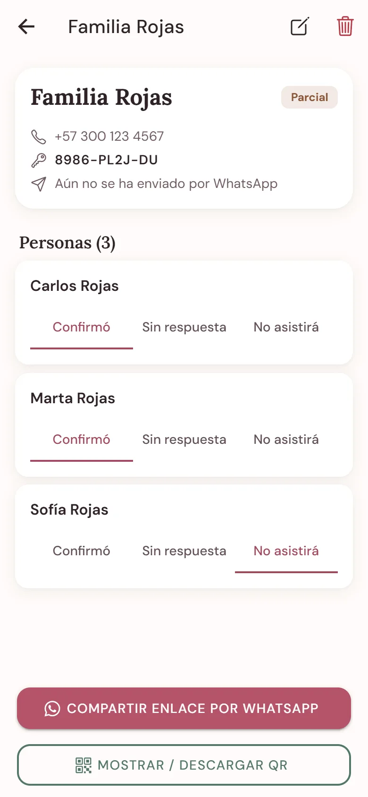 | 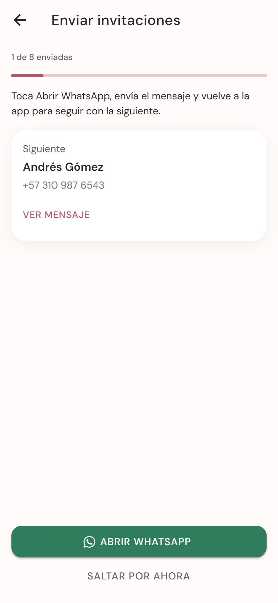 | 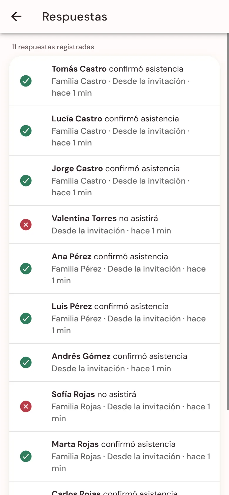 |

#### Regalos, presupuesto y tareas

- **Lista de regalos (solo propietarios):** soporta regalos **únicos**,
  **repetibles** con tope máximo de familias, **regalo libre**, **sugerencias**
  ("básicos que nunca sobran") y **lluvia de sobres**. Las reservas son
  anónimas: el panel solo muestra cuántas familias eligieron cada ítem, nunca
  quién lo apartó.
- **Presupuesto y gastos (solo propietarios):** presupuesto total en COP,
  categorías configurables, gastos con abonos parciales, asignación de quién
  pagó usando perfiles del equipo (`team_profiles`), totales de **comprometido,
  pagado, por pagar y disponible** y estado calculado automáticamente
  (`Pendiente`, `Abonado` o `Pagado`).
- **Tareas:** asignación a un perfil responsable, fecha límite, agrupación entre
  próximas y hechas, y enlace opcional entre una tarea y un gasto del
  presupuesto.

| Lista de regalos | Presupuesto y gastos | Tareas del equipo |
|:---:|:---:|:---:|
| 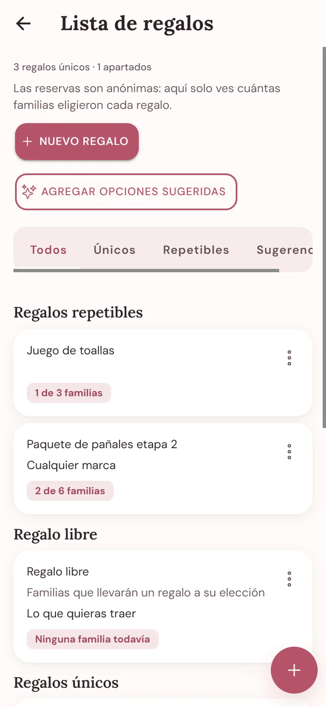 | 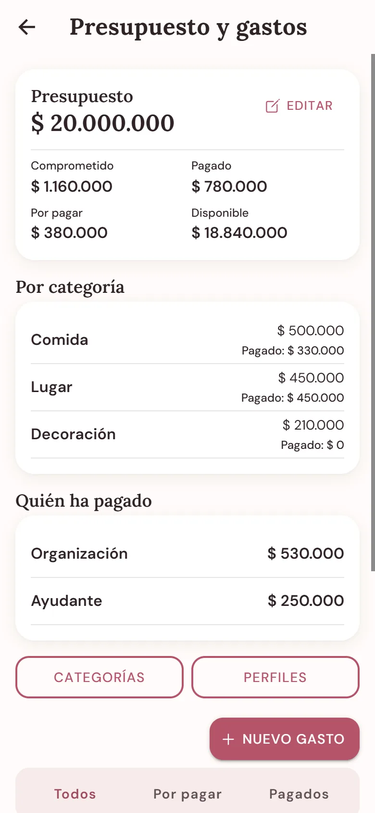 | 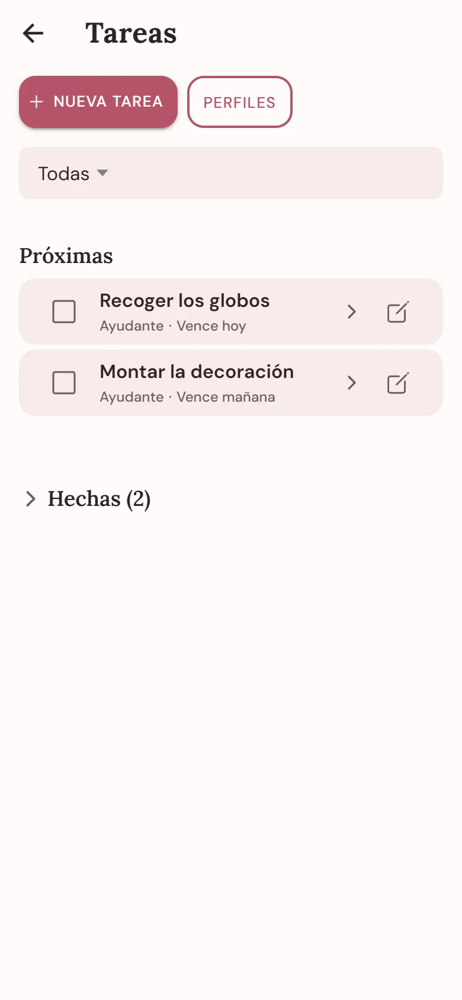 |

#### Llegadas en la entrada y galería compartida

- **Registro de llegadas:** lector QR en la entrada con búsqueda manual por
  nombre o código como respaldo. Guarda una copia local de la lista y encola
  los registros sin conexión para sincronizarlos en cuanto vuelve la señal.
- **Galería del evento:** cuadrícula compartida con límite de 300 fotos por
  evento, visor a pantalla completa, captura con cámara o selección múltiple
  desde la galería del teléfono (hasta 10 fotos por lote) y compresión previa en
  el dispositivo.

| Control de llegadas | Galería del evento |
|:---:|:---:|
| 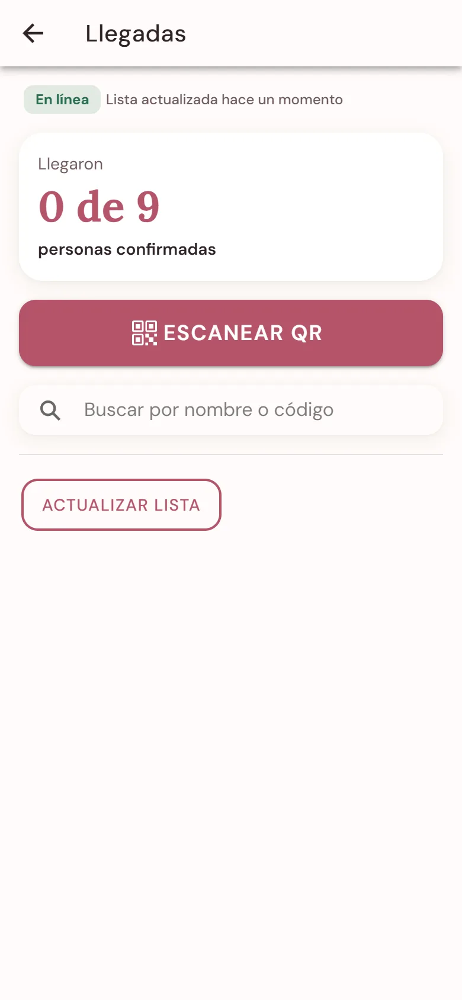 | 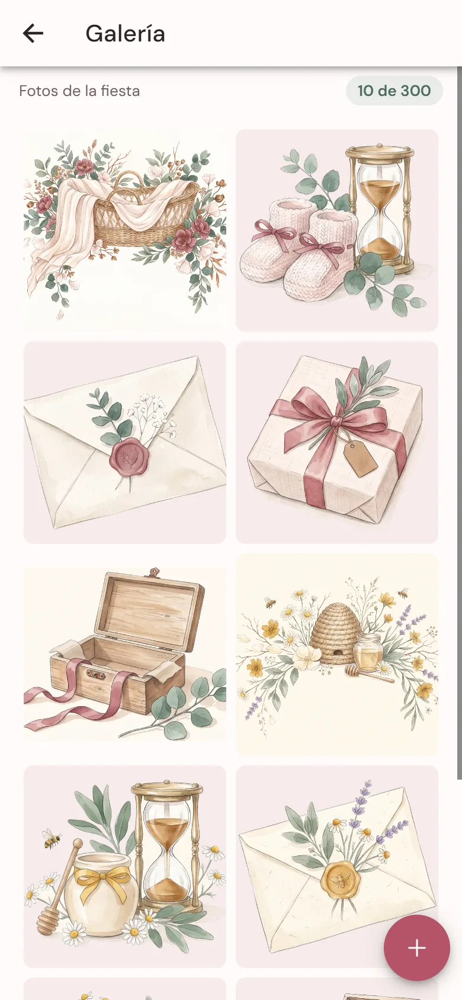 |

---

### Vista web para invitados

- **Video de bienvenida adaptativo:** si el tema lo incluye (`honey-bee`), se
  reproduce al abrir el enlace en la web con tope de 8 segundos y botón para
  saltarlo. Se omite automáticamente en la app nativa, cuando el navegador pide
  movimiento reducido (`prefers-reduced-motion`), ahorro de datos (`saveData`) o
  conexiones `2g` / `slow-2g`.
- **Invitación personalizada:** portada ilustrada, saludo individual o grupal,
  fecha, hora, lugar y enlace directo al mapa, más el código QR de entrada para
  mostrarlo al llegar.
- **Confirmación por persona:** cada integrante del grupo marca `Acepto` o
  `No acepto` hasta la fecha límite de su tanda (con cambio libre dentro del
  plazo).
- **Ventana de regalos:** los textos se adaptan al `event_type` y a
  `honoree_name` (por ejemplo, voz en primera persona del bebé en un baby
  shower). Incluye filtro entre regalos únicos y repetibles, paginación de 6 por
  página, sugerencias, lluvia de sobres, aviso de anonimato y liberación de
  regalos propios.

| Invitación web | Confirmación por persona | Ventana de regalos |
|:---:|:---:|:---:|
|  | 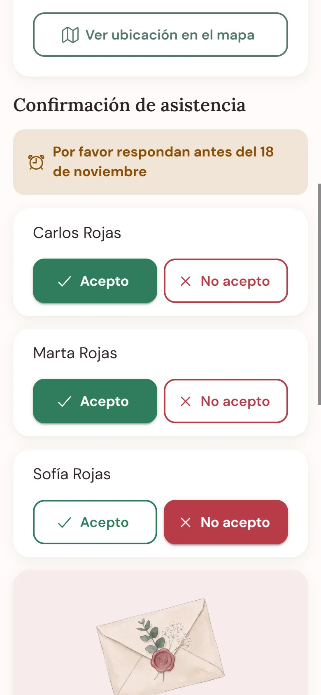 | 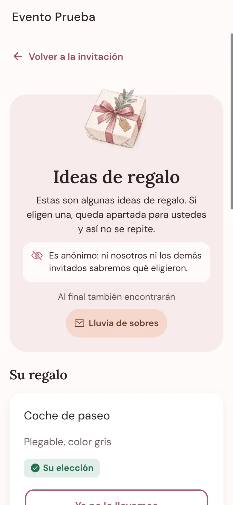 |

---

## Hardware y permisos

La app usa la cámara del dispositivo en dos flujos:

- **Galería de fotos** mediante `@capacitor/camera`.
- **Lector de QR de llegadas** mediante `@capacitor/barcode-scanner` (con la
  librería ML Kit en Android).

El permiso `android.permission.CAMERA` está declarado en
[AndroidManifest.xml](android/app/src/main/AndroidManifest.xml), pero Android
exige autorización en tiempo de ejecución:

1. Antes de abrir la cámara o el escáner, `CameraPermissionService` consulta el
   estado actual con `checkPermissions()`.
2. Si el permiso está pendiente (`prompt` o `prompt-with-rationale`), solicita la
   autorización con `requestPermissions({ permissions: ['camera'] })`.
3. Si el usuario lo niega una vez, la app muestra un aviso claro sin cerrarse.
4. Si lo niega de forma definitiva (`denied` tras dos rechazos), Android deja de
   mostrar el diálogo del sistema. La app lo detecta y ofrece un botón que abre
   directamente los ajustes del sistema para Convite mediante un plugin nativo
   propio escrito en Java
   ([AppSettingsPlugin.java](android/app/src/main/java/com/juanfierro/convite/AppSettingsPlugin.java)),
   ya que ningún plugin oficial de Capacitor incluye esa acción.

Para elegir imágenes existentes se usa el **selector de fotos del sistema**
(Photo Picker de Android, incluyendo compatibilidad en Android 11 y 12 mediante
`ModuleDependencies` en el manifiesto), que entrega únicamente las fotos
seleccionadas por la persona sin pedir permiso general de almacenamiento.

Cada foto capturada o elegida se procesa en el teléfono con `PhotoCompressor`
antes de subirse:

- La imagen principal se escala a un máximo de **1600 px** por lado en JPEG con
  calidad **80** (`0.8`), con tope estricto de **2 MB** (en pruebas reales una
  foto de 3–8 MB baja a unos 170–290 KB).
- Se genera además una miniatura cuadrada de **400 × 400 px** centrada con
  calidad **75** (`0.75`).
- Ambos archivos se suben al bucket privado `event-photos` de Supabase Storage.

---

## Reglas del negocio

| Área | Regla |
|---|---|
| Fechas, moneda e idioma | Fechas y horas formateadas en `es-CO` con zona `America/Bogota`; montos en pesos colombianos (COP) |
| Códigos de invitación | 10 caracteres alfanuméricos sin caracteres ambiguos (`ABCDEFGHJKLMNPQRSTUVWXYZ23456789`), únicos por invitación y normalizados al buscar |
| Teléfonos celulares | Formato colombiano `+57` seguido de 10 dígitos iniciando por `3` (`^\+573[0-9]{9}$`), validado en cliente y en PostgreSQL |
| Confirmaciones (RSVP) | Cada integrante tiene estado `pending`, `accepted` o `declined`; el invitado puede cambiar su respuesta por web hasta el `rsvp_deadline` de su tanda o del evento |
| Tandas de invitaciones | Cada tanda (`invitation_batches`) tiene su propia fecha límite, que no puede pasar del inicio del evento (`rsvp_deadline <= events.starts_at`); si una invitación no tiene tanda asignada, usa la fecha límite del evento |
| Registro de respuestas | Un disparador (`guests_log_rsvp`) registra en `rsvp_log` cada cambio de estado indicando si vino de la invitación (`guest`) o de la app (`team`) |
| Regalos y anonimato | Máximo un regalo `free` por evento; los `unique` solo pueden tener una reserva activa (índice único parcial contra concurrencia); en `repeatable` el tope de familias se valida bajo bloqueo; `get_gifts` nunca devuelve quién apartó un regalo y el ayudante tiene bloqueado el acceso |
| Llegadas sin conexión | `record_arrivals` es idempotente: guarda la hora original tomada al escanear en el celular y no sobrescribe una llegada ya registrada |
| Galería de fotos | Tope de **300 fotos** por evento validado con bloqueo transaccional en la base de datos (`event_photos_before_insert`); exige que foto y miniatura existan en Storage antes de insertar el registro |
| Presupuesto y tareas | El estado del gasto es calculado (`Pendiente`, `Abonado` si `0 < pagado < monto`, `Pagado` si `pagado >= monto`); las categorías con gastos y las tandas con invitaciones no se pueden borrar mientras tengan registros asociados |

---

## Arquitectura

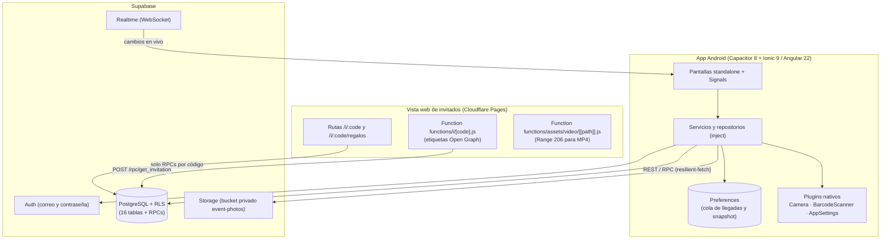

**Sin Zone.js y con servicios desacoplados.** Las pantallas no llaman
directamente a Supabase ni a los plugins de Capacitor: consumen servicios
inyectados con `inject()` y guardan toda respuesta en `signal()` para que
Angular actualice la vista sin Zone.js. La estrategia `AudiencePreloadingStrategy`
precarga módulos según la audiencia de la ruta (`guest` vs. organizadores).

**Resiliencia de red.** `createResilientFetch` envuelve `fetch` con tiempos límite
(10 s para consultas y 15 s para Auth), detección de conexión lenta a los 4 s,
reintentos con backoff y jitter sobre peticiones idempotentes (`GET`, `HEAD`, `PATCH`,
`DELETE`) y RPCs idempotentes (`get_invitation`, `get_gifts`, `set_rsvp`,
`reserve_gift`, `save_invitation`, `record_arrivals`). Al volver la app de
segundo plano (`App.resume` o `visibilitychange`), `RealtimeService` dispara una
recarga para no perder cambios ocurridos con el canal caído.

**Funciones de Cloudflare Pages.** `functions/i/[code].js` consulta
`get_invitation` en el servidor e inyecta metaetiquetas Open Graph del evento
(nombre, fecha, lugar e imagen del tema, sin nombres de invitados) mediante
`HTMLRewriter`, evitando que WhatsApp muestre una tarjeta genérica.
`functions/assets/video/[[path]].js` atiende el video de bienvenida con soporte
para encabezados `Range` y respuestas `206 Partial Content`.

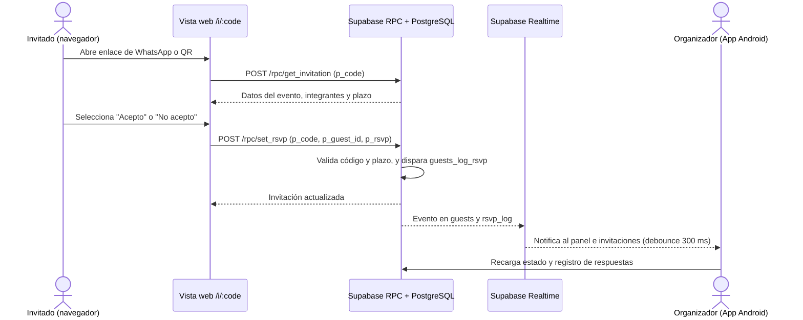

---

## Seguridad

- **Row Level Security (RLS) en las 16 tablas:** activado desde la misma
  migración que crea cada tabla. Las reglas críticas viven en PostgreSQL y no
  dependen de la interfaz.
- **Invitado sin acceso a tablas:** el rol anónimo (`anon`) no tiene permisos
  sobre ninguna tabla; solo puede ejecutar las cinco funciones `SECURITY DEFINER`
  del invitado (`get_invitation`, `set_rsvp`, `get_gifts`, `reserve_gift`,
  `release_gift`), que validan el código de invitación en cada llamada.
- **Separación entre propietario y ayudante:** el ayudante no pasa `roleGuard`
  en las rutas de edición de evento, regalos ni presupuesto, y además la base de
  datos bloquea sus consultas sobre `gifts`, `gift_reservations`, `expenses`,
  `expense_categories`, `expense_payments` y `get_gifts`.
- **Storage privado:** el bucket `event-photos` no es público (`public = false`,
  límite de 2 MB, solo `image/jpeg`). Solo miembros del evento pueden leer o
  subir archivos en la carpeta `<event_id>/`, y únicamente quien subió la foto o
  un propietario puede eliminar tanto el objeto en Storage como su fila en
  `event_photos`.
- **Sin secretos en el cliente:** la app y Cloudflare Pages solo usan la clave
  publishable de Supabase. La `SUPABASE_SECRET_KEY` vive únicamente en `.env`
  (excluido de Git) para las pruebas de reglas y el script de mantenimiento.
- **Encabezados de seguridad en web:** `functions/i/[code].js` y `src/web/_headers`
  aplican `X-Frame-Options: DENY`, `Content-Security-Policy: frame-ancestors 'none'`,
  `Permissions-Policy` restrictiva y `X-Robots-Tag: noindex, nofollow` para no
  indexar enlaces privados de invitación.

---

## Modelo de datos

El esquema evoluciona mediante **20 migraciones** en `supabase/migrations/` y
consta de **16 tablas**, todas con RLS habilitado:

| Tabla | Propósito |
|---|---|
| `events` | Eventos, tema, tipo (`event_type`), festejado (`honoree_name`), lugar, fecha, límite RSVP y presupuesto en COP |
| `event_members` | Miembros de cada evento (`owner` o `helper`) y su nombre visible (`display_name`) |
| `teams` | Equipos reutilizables de organizadores (administrados desde SQL) |
| `team_members` | Integrantes de un equipo que se agregan automáticamente al crear un evento |
| `team_profiles` | Perfiles visibles dentro del equipo para asignar tareas y registrar quién pagó un gasto |
| `invitation_batches` | Tandas de invitaciones con fecha límite de confirmación propia |
| `invitations` | Invitaciones individuales o de grupo, teléfono `+57`, código único, tanda y marca de envío por WhatsApp |
| `guests` | Personas de cada invitación, su estado de confirmación (`rsvp`), hora de respuesta y registro de llegada |
| `rsvp_log` | Historial inmutable de cambios de respuesta generado por disparador (`guests_log_rsvp`) |
| `gifts` | Regalos del evento (`unique`, `repeatable`, `free`, `suggestion`, `envelope`) y tope máximo |
| `gift_reservations` | Apartados anónimos de regalos por invitación; índice único parcial para regalos `unique` |
| `expense_categories` | Categorías de gasto propias de cada evento |
| `tasks` | Tareas del evento con perfil responsable, fecha límite y marca de finalización |
| `expenses` | Gastos del presupuesto asociados a categoría y, opcionalmente, a una tarea |
| `expense_payments` | Abonos realizados a cada gasto con fecha y perfil que pagó |
| `event_photos` | Metadatos de fotos de la galería (`width`, `height`, pesos y rutas generadas al bucket privado) |

**Funciones RPC públicas:**

- **Para invitados (`anon` y `authenticated`):** `get_invitation`, `set_rsvp`,
  `get_gifts`, `reserve_gift`, `release_gift`.
- **Para organizadores (`authenticated`):** `save_invitation`, `save_task`,
  `set_task_done`, `delete_task`, `record_arrivals`, `list_rsvp_log`,
  `can_manage_profiles`.

---

## Stack tecnológico

| Área | Tecnología | Versión (`package.json`) |
|---|---|---|
| Framework UI | Ionic Angular (`@ionic/angular`) · Ionicons | `^9.0.0` · `^8.1.0` |
| Aplicación web | Angular (standalone, signals, sin Zone.js) | `22.2.3` |
| Lenguaje y estilos | TypeScript · SCSS · DM Sans / Lora (`@fontsource`) | `~6.0.0` · `^5.3.0` |
| Runtime móvil | Capacitor (`@capacitor/core`, `@capacitor/android`) | `8.5.3` |
| Plugins nativos | Camera `8.2.6` · Barcode Scanner `3.1.3` · Preferences `8.0.1` · Network `8.0.1` · App `8.1.2` · Filesystem `8.1.5` · Share `8.0.3` · Haptics `8.0.2` · Keyboard `8.0.6` · Status Bar `8.0.4` | según `package.json` |
| Backend y datos | `@supabase/supabase-js` (PostgreSQL, RLS, Auth, Realtime, Storage) | `^2.118.0` |
| Códigos QR | `qrcode` (generación) · `@capacitor/barcode-scanner` (lectura ML Kit) | `^1.5.4` · `3.1.3` |
| Hosting web | Cloudflare Pages + Pages Functions (`wrangler`) | `4.152.0` |
| Pruebas | Vitest + `jsdom` + `node:test` | `~5.0.5` · `^30.1.1` |
| Calidad de código | ESLint + `angular-eslint` + `typescript-eslint` | `^10.10.0` · `22.6.0` · `^8.61.0` |

---

## Estructura del proyecto

```text
android/                       Proyecto nativo de Android (incluye AppSettingsPlugin.java y AndroidManifest.xml)
docs/capturas/                 Capturas en WebP usadas en este README
functions/                     Cloudflare Pages Functions para la vista web de invitados
├── _lib/                      Configuración, cálculo de rangos HTTP y armado de tarjetas Open Graph
├── assets/video/[[path]].js   Servicio de video MP4 con soporte para Range (206 Partial Content)
└── i/[code].js                Inyección de etiquetas Open Graph por invitación sin exponer invitados
scripts/
├── funciones/                 Pruebas unitarias de las Pages Functions (node:test)
├── mantenimiento/             Script borrar-evento.mjs, fotos-huerfanas.mjs y sus pruebas
└── reglas/                    Pruebas de reglas de negocio y seguridad RLS contra Supabase
src/
├── app/
│   ├── core/                  Servicios inyectados, modelos, utilidades puras y guardas
│   │   ├── arrivals/          Escáner QR, cola offline en Preferences, sincronización y guarda
│   │   ├── auth/              Sesión de Supabase Auth y AuthGuard
│   │   ├── data/              Repositorios (eventos, invitaciones, regalos, presupuesto, tareas, perfiles, respuestas, tandas)
│   │   ├── events/            Contexto del evento activo y RoleGuard
│   │   ├── models/            Interfaces TypeScript por dominio
│   │   ├── photos/            Permisos de cámara, plugin AppSettings, compresor en canvas, caché y subida a Storage
│   │   ├── realtime/          Suscripciones Realtime con debounce y reconexión al volver del fondo
│   │   ├── routing/           Precarga diferenciada por audiencia (AudiencePreloadingStrategy)
│   │   ├── supabase/          Cliente Supabase, tipos generados y resilient-fetch
│   │   ├── theme/             Registro de temas (baby-shower, honey-bee) y ThemeService
│   │   └── utils/             Fechas es-CO, dinero COP, teléfonos +57, códigos, WhatsApp y paginación
│   ├── features/              Pantallas standalone por módulo
│   │   ├── auth/              Inicio de sesión
│   │   ├── eventos/           Lista, formulario y panel del evento
│   │   ├── galeria/           Galería en cuadrícula y visor a pantalla completa
│   │   ├── invitaciones/      Lista, detalle, formulario, QR y envío en serie por WhatsApp
│   │   ├── invitado/          Vista web (/i/:code), video introductorio y ventana de regalos (/i/:code/regalos)
│   │   ├── llegadas/          Registro de llegadas con escáner QR y agrupación familiar
│   │   ├── perfiles/          Administración de perfiles del equipo
│   │   ├── presupuesto/       Presupuesto, categorías, detalle de gasto y formularios de abono
│   │   ├── regalos/           Lista y formulario de regalos (solo propietario)
│   │   ├── respuestas/        Registro cronológico de cambios RSVP
│   │   └── tareas/            Lista y formulario de tareas
│   └── shared/                Componentes reutilizables (banners, estados vacíos, paginación, selector de tema, directiva COP)
├── assets/themes/             Portadas, íconos e ilustraciones por tema (baby-shower, honey-bee)
├── theme/                     Variables CSS globales y estilos por tema
└── web/                       Video, imágenes OG, _headers, _routes.json y robots.txt para el build web
supabase/migrations/           20 migraciones SQL con tablas, índices, disparadores, RLS y RPCs
```

---

## Instalación y uso local

**Requisitos:** Node.js 24, npm y la CLI de Ionic (`npm install -g @ionic/cli`).

```bash
git clone https://github.com/JuanFierro15/convite-app.git
cd convite-app
npm install
ionic serve
```

La app queda disponible en `http://localhost:8100`. En el navegador la cámara y
el lector de QR no están disponibles; esas funciones se prueban en el dispositivo
Android.

Las variables de Supabase para el cliente se encuentran en
`src/environments/environment.ts` (solo URL y clave publishable). Para ejecutar
las pruebas contra Supabase o los scripts de mantenimiento, copia `.env.example`
a `.env` y completa:

| Variable | Uso |
|---|---|
| `SUPABASE_URL` | URL del proyecto en Supabase |
| `SUPABASE_PUBLISHABLE_KEY` | Clave publishable (pública por diseño) |
| `SUPABASE_SECRET_KEY` | Clave secreta para `test:reglas` y `borrar-evento`; nunca se incluye en la app |

> **Nota sobre credenciales de prueba:** las cuentas de prueba para la revisión
> docente se entregan por aparte y no se almacenan en el repositorio.

### Instalar el APK en el celular

1. Descarga `app-debug.apk` desde el enlace de Google Drive de la entrega
   (Gmail bloquea archivos `.apk`).
2. Ábrelo desde el celular. Android preguntará si permites instalar apps desde
   esa fuente (navegador o gestor de archivos); acepta solo para esa instalación.
3. Toca **Instalar** y luego **Abrir**.
4. Inicia sesión con la cuenta compartida aparte.
5. La primera vez que uses la galería o el lector QR, Android solicitará el
   permiso de cámara; si lo niegas, la app muestra cómo habilitarlo desde
   ajustes.

Compatible con **Android 8.0 (API 26)** o superior.

---

## Pruebas

La suite suma **1409 pruebas automatizadas**:

```bash
npm test                  # 1207 pruebas unitarias en 95 archivos (Vitest)
npm run test:reglas       # 111 pruebas de reglas de negocio y RLS contra Supabase
npm run test:funciones    # 53 pruebas de las Cloudflare Pages Functions
npm run test:mantenimiento # 38 pruebas del script de mantenimiento
npm run lint              # ESLint sobre src/**/*.ts y src/**/*.html
```

- `npm test` cubre lógica pura (fechas `es-CO`, dinero COP, teléfonos `+57`,
  códigos, estados, paginación, resúmenes de presupuesto, texto de invitados),
  servicios (`resilient-fetch`, `RealtimeService`, compresión de fotos, cola
  offline de llegadas, permisos de cámara) y páginas/componentes.
- `npm run test:reglas` requiere `.env` configurado con las tres variables de
  `.env.example`. Se ejecuta en serie (`--test-concurrency=1`), crea sus propios
  usuarios y eventos de prueba y los elimina al terminar.
- `npm run test:funciones` verifica la generación de tarjetas Open Graph, los
  encabezados de seguridad y las respuestas parciales `206` del video.

---

## Generar el APK

**Requisitos:** Android Studio y **JDK 21** (el JDK integrado que trae Android
Studio no es compatible con la versión de Gradle usada por Capacitor).

```bash
ionic build
npx cap sync android
npx cap open android
```

En Android Studio: **Build > Build Bundle(s) / APK(s) > Build APK(s)**. El
archivo compilado queda en `android/app/build/outputs/apk/debug/app-debug.apk`.

Cada cambio en el código web requiere ejecutar de nuevo `ionic build` y
`npx cap sync android` antes de volver a generar el APK; de lo contrario se
empaqueta la versión anterior.

---

## Despliegue

La vista web para invitados se aloja en **Cloudflare Pages**
(<https://convite-4v8.pages.dev>) en el plan gratuito:

```bash
npm run deploy:web
```

Este comando ejecuta `ng build --configuration production,web` (que copia los
activos de `src/web/` —video de bienvenida, imágenes Open Graph, `_headers`,
`_routes.json` y `robots.txt`— dentro de `www/`) y publica el directorio `www`
junto con la carpeta `functions/` mediante `wrangler pages deploy`.

---

## Avance por etapas

| Módulo / bloque | Estado |
|---|:---:|
| Base del proyecto, autenticación, eventos, invitaciones, invitados, regalos y RLS inicial | ✅ |
| Llegadas con lector QR, cola sin conexión y capa `resilient-fetch` | ✅ |
| Temas visuales (`baby-shower` y `honey-bee`) y video de bienvenida web | ✅ |
| Regalos repetibles con tope, sugerencias, lluvia de sobres y anonimato | ✅ |
| Invitaciones individuales, validación celular `+57` y envío en serie por WhatsApp | ✅ |
| Presupuesto, categorías, gastos con abonos, perfiles de equipo y tareas | ✅ |
| Registro cronológico de respuestas (`rsvp_log`) y vista en tiempo real | ✅ |
| Galería compartida del evento con compresión local y bucket privado | ✅ |
| Tandas de invitaciones con fechas límite independientes | ✅ |
| Vista previa Open Graph en enlaces de WhatsApp (Cloudflare Pages Functions) | ✅ |
| Adaptación de textos por tipo de evento y persona festejada | ✅ |

---

## Pendiente

- Asignación de mesas (actualmente desactivada detrás de la bandera
  `TABLES_ENABLED` en `src/app/core/features.ts`).
- Recordatorios automáticos por WhatsApp.
- Textos de la invitación editables por evento desde la app.

---

## Autor

**Juan Fierro** · [@JuanFierro15](https://github.com/JuanFierro15)

Proyecto académico de la Universidad Surcolombiana.
